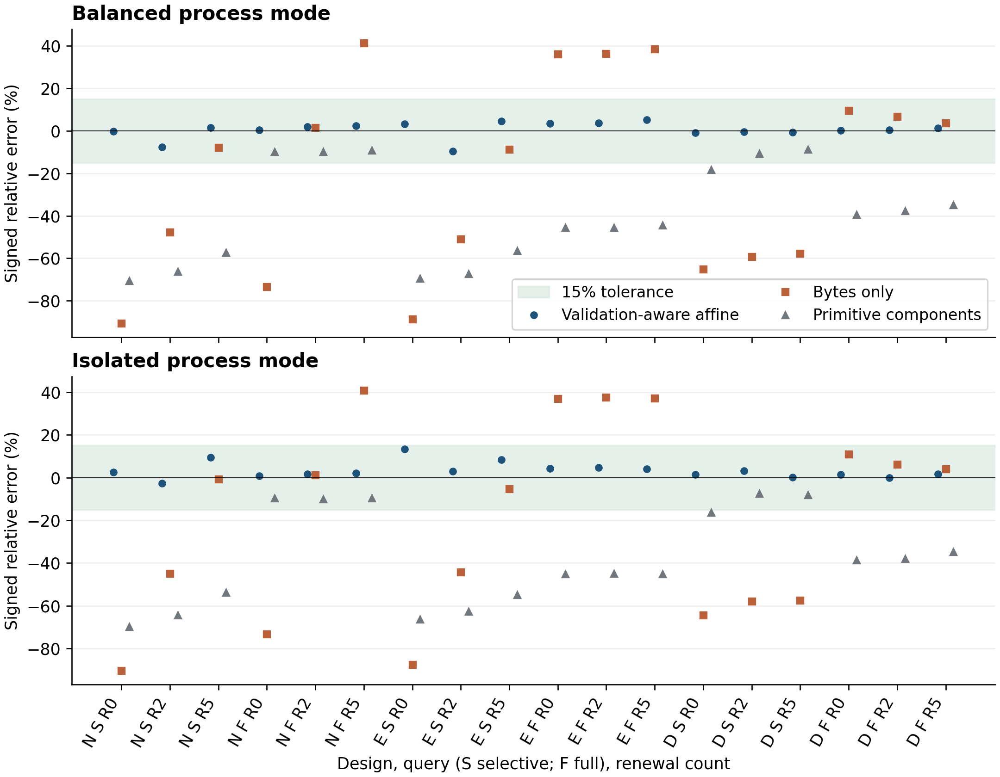

# VITAL-Q

Reproducibility package for the paper *Predicting Verification Latency for Post-Quantum
Archival Evidence* by Arindam Chakraborty, Saikat Chakraborty, Soham Marik and Sambit Dhar.

The package replays the published numerical results from the retained observations, re-verifies
the retained cryptographic proofs, runs a reduced end-to-end check in minutes or collects a new
full-scale measurement campaign on your own machine. Releases: **v1** is the package; **v2** adds
the manuscript with the response to the reviewers under `manuscript/`.

---

## 1. What the paper asks

Long-lived evidence must stay verifiable while signing keys and algorithms change. Evidence
Record Syntax describes renewal chains with tree-based aggregation, so the structures are known.
The operational question here is narrower:

> **Can a cost model calibrated on small archives predict how long it takes to verify a complete
> request against an archive ten times larger?**

Counting signatures does not answer it. A verifier also parses evidence, validates canonical
manifests, binds the proof to the caller's request, checks enrollment with predecessor links,
reconstructs the tree path, then applies the eligibility policy. An earlier campaign reconciled
its byte ledger yet underpredicted latency by a median of 44.70%; a measurement review also found
a reused result variable inside the timing boundary.

This study fixes the timer, freezes a seven-term **validation-aware affine model** before any
evaluation data is collected, then tests it on fresh, larger archives.

### The model

Predicted latency for one complete query is a nonnegative linear combination of counted work:

```
t = α + c_m·m + c_E·vE + c_M·vM + c_S·vS + c_e·e + c_h·h
```

| Term | Counts |
| --- | --- |
| `α` | fixed per-query overhead |
| `m` | validated canonical manifests |
| `vE`, `vM`, `vS` | ECDSA P-256, ML-DSA-65 and SLH-DSA SHA2-192f token checks |
| `e` | enrollment objects |
| `h` | internal Merkle hashes |

Coefficients were fitted by nonnegative least squares on **432 balanced development
observations** aggregated into 36 cell medians, at design rank 7 with normalized condition
number 6.19. **No evaluation timing entered the fit.**

### Experimental grid

Three evidence designs (**N**, **E**, **D**) at **R = 0, 2 and 5 renewals**, each with full and
selective queries, give **18 evaluation conditions**. N and E start with ECDSA P-256 then use
ML-DSA-65; D adds a parallel SHA-384 tree with an SLH-DSA branch. Query order follows a six-row
Williams design so every task appears equally often in each position with all 30 ordered
predecessor pairs balanced.

| Phase | Archive size | Histories | Measurements |
| --- | ---: | ---: | ---: |
| Development (fit) | 1,000 then 10,000 records | 72 | 864 |
| Evaluation (test) | 100,000 records | 90 | 1,080 |

Two timing modes are reported separately. In **balanced** mode one worker persists across the six
query tasks of a history. In **isolated** mode every query gets a fresh worker. Both warm the
proof file with explicit garbage collection before the timed call, so these are **warm-cache**
measurements rather than end-to-end service times.

### What was found

| Model | Balanced median abs. rel. error | Conditions within ±15% |
| --- | ---: | ---: |
| **Validation-aware affine (frozen)** | **1.63%** | **18/18** |
| Bytes only | 39.86% | 6/18 |
| Primitive components | 41.98% | 5/18 |

Without refitting, the same frozen model reached **2.55%** median error with **18/18** passes in
isolated mode. The prespecified paired difference against the bytes-only baseline was **-38.23
percentage points**, conditional 95% interval **[-38.63, -36.50]**, where negative favours the
corrected model. Paired isolated-to-balanced latency ratios ranged from 0.902 to 1.009.

All fresh archive and query ledgers reconciled, **233/233** verifier qualification checks passed
and **486/486** retained selective proofs were re-verified. Separately from latency, batching in
the fixed envelope means that at 100,000 records with five renewals design E uses **94.02%** less
evidence storage than N, with D using **93.21%** less.

---

## 2. The result in one figure



**How to read it.** Each panel is one timing mode. The horizontal axis walks the 18 evaluation
conditions as *design, query, renewal count*, where `N S R0` means design N, selective query, zero
renewals and `F` marks a full query. The vertical axis is signed relative error, so a point above
zero means the model predicted more time than was observed. The green band is the prespecified
±15% tolerance.

Three series appear per condition. The blue circles are the frozen validation-aware model: they
sit inside the band at every condition in both panels. The orange squares are the bytes-only
baseline, which swings from roughly -90% to +41%, so it both over and underpredicts depending on
where the work actually falls. The grey triangles are the separately calibrated primitive
component model, which is biased low almost everywhere because it misses parsing with validation
cost.

The figure is regenerated by every run that produces an analysis, in PNG at 240 dpi with a
vector SVG beside it.

---

## 3. What is in the package

| Path | Contents |
| --- | --- |
| `src/release/` | the 25-file frozen scientific release: verifier, archive builder, timing helpers, calibration, model fitting, analysis, protocol, schedule, fitted coefficients |
| `src/replay_checks.py` | numerical replay of the published results |
| `src/make_figures.py` | figure generation from an analysis file |
| `data/published/` | the original measured rows, saved analyses, audit records and all retained selective proofs with their enrollment policies |
| `scripts/` | portable orchestration (`reproduce.py`), history journal, local checkpoint adapter, notebook cell runner, execution auditor |
| `notebooks/` | `Reproduce.ipynb` control notebook; `Published_Analysis_Executed.ipynb` original executed analysis |
| `native/` | bundled Linux x86-64 liboqs build with headers, build receipt and license |
| `executions/full_scale_20261012/` | a complete recorded full-scale run, described in section 7 |
| `validation/` | every check performed while preparing this package, with its limits |
| `manuscript/` | the v2 manuscript with the point-by-point response to the reviewers |
| `REFERENCE_SHA256.json` | digests of the immutable supplied files; checked before every run |
| `SHA256SUMS.txt` | digests of every packaged file |

`.gitattributes` disables newline conversion for the frozen trees so their bytes survive cloning.

---

## 4. Before you start

| Requirement | Detail |
| --- | --- |
| Operating system | Linux for cryptographic modes. Windows uses WSL2. macOS uses the container recipe. |
| Python | 3.12 |
| Disk | at least 10 GB free for a full campaign; the runner also enforces the original per-history disk check |
| Network | needed once during setup to install dependencies; replay then runs offline |
| Time | replay takes minutes; a full fresh campaign takes hours |

Numerical replay alone does not need liboqs. Proof verification and fresh collection do.

---

## 5. Step by step

### Step 1 — get the package

```bash
git clone https://github.com/bdata-arindam/VITAL-Q.git
cd VITAL-Q
```

### Step 2 — create the environment

Full environment, including the cryptographic stack:

```bash
bash setup.sh
```

Numerical replay only, a smaller dependency set:

```bash
bash setup.sh replay
```

Either command creates `.venv` then installs the pinned requirements. If the bundled Linux
x86-64 liboqs does not match your machine, install Git, CMake with a C compiler, then build the
pinned native dependency:

```bash
bash setup.sh full --build-native
```

The build writes a local prefix that `run.sh` picks up automatically. `OQS_INSTALL_PATH` selects
a different installation. `VITAL_Q_SETUP_PYTHON` selects a different interpreter for the venv;
`VITAL_Q_PYTHON` selects one for the run.

### Step 3 — replay the published results

```bash
bash run.sh replay
```

This checks the frozen files against `REFERENCE_SHA256.json`, refits nothing, recomputes the
published comparison, re-executes all six cells of the original analysis notebook in one shared
namespace inside an isolated subprocess, then regenerates the figures.

### Step 4 — verify the retained cryptographic evidence

```bash
bash run.sh verify
```

The original verifier runs over all 486 retained selective proofs with their enrollment policies,
checking the ledger, the schedule and time ordering.

### Step 5 — run the quick end-to-end check

```bash
bash run.sh smoke
```

Smoke mode keeps the full 162-history workflow with all six tasks and both timing modes, at sizes
32, 128 and 256 instead of the paper's sizes. It exercises generation, qualification, calibration,
checkpoints, pre-evaluation freezing, fitting, evaluation, analysis, proof verification and plots.
**Smoke results are an engineering check, never paper-scale evidence.**

### Step 6 — collect fresh full-scale measurements

```bash
bash run.sh fresh
```

This runs the complete campaign: 72 development histories at 1,000 and 10,000 records, then 90
evaluation histories at 100,000 records. Fresh latency values with randomized signature bytes are
expected to differ from the original experiment. Run it without other benchmark workers competing
for CPU or disk.

Both reproduction paths in sequence:

```bash
bash run.sh all
```

Choose where the output goes:

```bash
bash run.sh fresh --output /absolute/path/to/new-run
```

### Step 7 — audit the included recorded run

```bash
.venv/bin/python scripts/audit_execution.py
```

### Notebook alternative

`notebooks/Reproduce.ipynb` is a single control notebook offering **1 = published replay**,
**2 = full fresh run**, **3 = both**. Option 3 also verifies retained proofs. It launches the same
driver as `run.sh` then displays the output figures.

### Container alternative

The Dockerfile builds liboqs from the original pinned commit rather than using the bundled binary:

```bash
docker build -t vital-q-reproduce .
mkdir -p outputs
docker run --rm -v "$PWD/outputs:/outputs" vital-q-reproduce replay --output /outputs/replay
docker run --rm -v "$PWD/outputs:/outputs" vital-q-reproduce fresh  --output /outputs/fresh
```

Docker was not available in the packaging environment, so the container build is supplied as an
unexecuted deployment recipe. `validation/VALIDATION.md` records which paths were actually tested.

---

## 6. What each command produces

Every mode writes to a new timestamped directory under `runs/`. An existing output directory is
refused. Supplied sources with published observations are checksum-checked before and after
execution; they are never overwritten.

| Mode | What it executes | What it establishes |
| --- | --- | --- |
| `replay` | frozen-file checks, numerical refit with comparison, 10,000-draw bootstrap, timer tests, six notebook cells, plot regeneration | agreement with the supplied observations and saved results |
| `verify` | original verifier over all 486 retained selective proofs; ledger, schedule and time-order checks | validity of the retained evidence under the supplied enrollment policies |
| `smoke` | the full workflow at sizes 32, 128 and 256 | end-to-end engineering check, not paper-scale replication |
| `fresh` | the full campaign at 1,000, 10,000 then 100,000 records | new full-scale measurements in your own environment |
| `all` | replay, proof verification then the fresh campaign | retained-result reproduction together with a new run |

### Output map

| File | What it holds |
| --- | --- |
| `REPRODUCTION_STATUS.json` | completion status with scope |
| `REPLAY_REPORT.json` | published numerical comparison results |
| `revision/results/analysis.json` | the full analysis: per-mode, per-size, per-model cells |
| `revision/results/model_cells.csv` | one row per model cell, described below |
| `revision/figures/prediction_errors.png` and `.svg` | the figure of section 2 |
| `revision/VITAL_Q_Analysis_Reexecuted.ipynb` | the original notebook re-executed with outputs (replay mode) |
| `revision/measured/` | raw rows, history records, barrier traces, per-history journals (fresh and smoke) |
| `revision/audit/` | qualification, freezing, validation and portability records |
| `revision/retained/` | selective proofs with their enrollment policies |
| `revision/logs/` | subprocess output |
| `pre_evaluation_snapshot.zip` | local snapshot saved before fresh evaluation |
| `checkpoints/latest.zip` | checksum-checked local checkpoint after each completed history |

### Reading `model_cells.csv`

| Column | Meaning |
| --- | --- |
| `mode` | `balanced` or `isolated` |
| `model` | `validation_affine`, `bytes_only`, `micro_components` and the ablations |
| `arm`, `query`, `renewals`, `n` | the condition: design, full or selective, renewal count, archive size |
| `histories` | matched histories behind the row, 30 at evaluation scale |
| `observed_median_seconds`, `predicted_median_seconds` | measurement against prediction |
| `relative_error` | signed, as plotted in the figure |
| `point_pass` | absolute error at most 15%, the primary criterion |
| `error_interval_95`, `interval_pass` | pointwise bootstrap interval with whether it lies inside the tolerance |

A `passed` completion status means execution with consistency checks succeeded. It does not
guarantee that the model meets the paper's accuracy criterion on another machine. Inspect
`support_rule_passed` with the model errors in the new `analysis.json`.

A failed command stops the workflow then preserves logs with completed-history checkpoints.
Restart from a new output directory after resolving the failure; automatic resume of an
interrupted run is not implemented.

### Worked example you can check by hand

An E full query at n = 100,000 with R = 5 has k = 25 batches across G = 6 generations, giving
m = 100,000, vE = 25, vM = 125, vS = 0, e = 6 and h = n − k = 99,975. The current trees are
reconstructed once, so h is not multiplied by G. Applying the frozen coefficients from Table 4 of
the manuscript gives 1860.645 ms, which matches its Table 6. Recheck these counts when adapting
the model to another verifier.

---

## 7. The recorded full-scale run

`executions/full_scale_20261012/` holds a complete campaign executed on 12 October 2026, kept as
additional reproducibility evidence. It does not replace the paper's measurements.

| Check | Result |
| --- | --- |
| Total histories / measurements | 162 / 1,944 |
| Qualification checks | 233 / 233 passed |
| Retained selective proofs re-verified | 486 / 486 |
| Complete checksummed history journals | 162 / 162 |
| Model-cell rows reconciled to the analysis | 252 / 252 |
| Original reference-file hashes unchanged | 1,015 / 1,015 |
| Final checkpoint member hashes verified | 1,013 / 1,013 |
| Elapsed through the final checkpoint | 121.21 minutes |

| Mode | Published model error | Fresh model error | Fresh bytes-only | Point passes | Interval passes |
| --- | ---: | ---: | ---: | ---: | ---: |
| Balanced | 1.6316% | 2.1202% | 38.1448% | 18/18 | 17/18 |
| Isolated | 2.5545% | 2.2087% | 37.0715% | 18/18 | 16/18 |

Both modes passed the original support rule, which requires at least 15 point passes, at least
one point pass in each design and query stratum, then a lower median absolute relative error than
the bytes-only baseline. All point estimates passed; some intervals crossed the tolerance
boundary. `validation/FULL_SCALE_EXECUTION.md` gives the environment, the complete output map
and a disclosed initial cleanup failure.

---

## 8. How the integrity evidence works

- **Frozen inputs.** `REFERENCE_SHA256.json` pins every immutable supplied file. Each run checks
  it first then stops on any change.
- **Independent ledgers.** Archive bytes with observed operation counts are reconciled against a
  ledger computed separately from the measurement path.
- **Pre-evaluation freeze.** Code, schedule, model definitions, fitted coefficients, acceptance
  rules and development-input hashes are frozen before evaluation begins. The freeze receipt
  records a local integrity snapshot, which is neither public preregistration nor a trusted
  timestamp.
- **Journalled observations.** Each completed history commits its 12 actual in-memory
  measurements to an atomic checksummed journal after the workers stop. Combined files are
  rebuilt from those journals. **No missing latency is estimated or fabricated.**
- **Checkpoints.** `scripts/checkpoint.py` rebuilds aggregate rows from verified journals, checks
  that each completed history holds exactly all 12 expected observations, writes a ZIP with
  `fsync`, verifies its checksums, then replaces the previous checkpoint only on success.
  Incomplete or duplicated rows abort the save. This is a local recovery copy, not off-host
  backup or a trusted timestamp.
- **Retention rule.** Full archives with full-query proofs are generated, verified then discarded
  by the original storage design, which bounds disk use near 4 GiB. The 486 selective proofs are
  retained. Regeneration permits a new execution; it cannot recover the original randomized
  signature bytes.

---

## 9. Limitations

These are the authors' own bounds on the claim, carried here so that nobody reads the package as
more than it is.

- Development with evaluation used different archive sizes in sequential phases, so scale and
  collection time are not independently randomized.
- One virtualized host cannot establish cross-platform performance, dedicated-host
  reproducibility or tail-latency service guarantees.
- Bootstrap intervals are conditional on the fitted coefficients, pointwise across the fixed
  grid. They omit development-fit uncertainty; they do not provide simultaneous coverage.
- The coefficients are empirical allocations from jointly fitted complete queries, not
  independently measured operation costs. A single hardware speed multiplier is not established.
- Measurements are warm-cache. Production storage may add costs outside this boundary.
- Trusted enrollment with a modeled clock are external assumptions. A signature authenticates an
  asserted time value; it does not establish when the event occurred. The 233 qualification
  checks do not establish key custody, authentic enrollment or timely renewal.
- The timer fix is one of several changes, so the experiment evaluates the revised pipeline as a
  whole rather than isolating the defect.
- The retained MHEALTH example supplies functional artifact-integrity fixtures only. No clinical
  utility, device validation or authenticated physiological acquisition is claimed.
- Independent external replication has not been performed.

---

## 10. Future research scope

The manuscript names these directions; the package is built so that each can start from the
existing harness.

1. **Cold-cache verification.** Distinguish warm-cache verification from cold local retrieval,
   reporting client, operating-system and storage caches explicitly. Restarting a worker alone
   does not establish cold caches.
2. **Network and remote storage.** Measure remote object access as a separate span. Service
   experiments should record end-to-end elapsed time beside retrieval, proof-construction and
   verification spans, with concurrency, transferred bytes and network conditions. Overlapping
   stages need tracing that accounts for overlap rather than simple addition. Warm-cache local
   reads already sit inside the current timer, so an extended model must not count them twice.
3. **Cross-platform validation.** Repeat the frozen-model test on other instruction sets, parser
   implementations and cryptographic builds to find whether the term structure transfers even
   where the coefficients do not.
4. **Independent replication.** The strongest open item. Another team running the frozen protocol
   on its own hardware would test what one environment cannot.
5. **Richer verification work.** Variable-size records, certificate-path validation, revocation
   processing or timestamp checking may need terms beyond the present seven.
6. **Tail-latency guarantees.** The present criterion uses median relative error across a fixed
   grid. Production capacity planning needs a tail objective with its own acceptance rule.
7. **Attribution of the timer defect.** A separately controlled intervention, holding all other
   conditions fixed, would estimate how much of the earlier error the reused result variable
   caused.

---

## 11. Adapting the method to another system

1. Define the verification request, the acceptance policy then the timing endpoint.
2. Instrument the target verifier; reconcile its counts against an independent ledger.
3. Keep the seven terms only where they describe that verifier's work. Add terms for work it does
   that this one does not.
4. Collect representative development histories; fit the relative-error objective of Section 3.4
   of the manuscript, then check rank, conditioning and residuals by workload.
5. Freeze features, coefficients and the acceptance rule **before** testing fresh histories.
6. Recalibrate after any material environment change.

---

## 12. Manuscript and citation

`manuscript/` holds the v2 manuscript with the point-by-point response to the reviewers. The
response maps each comment to the section that answers it: generalization across platforms,
libraries and storage environments (5.2); calibration overhead with deployment requirements
(3.4.1); trusted enrollment, simulated timestamps and archival trust (3.1.1); model coefficients
with adaptation to other evidence systems (4.3 beside 5.2); cold-cache verification with network
retrieval (5.3).

The secondary MHEALTH dataset is publicly available at <https://doi.org/10.24432/C5TW22>. The
bundled liboqs license is in `native/licenses/`. Post-quantum signatures use liboqs through its
Python bindings; ECDSA uses `cryptography`.
